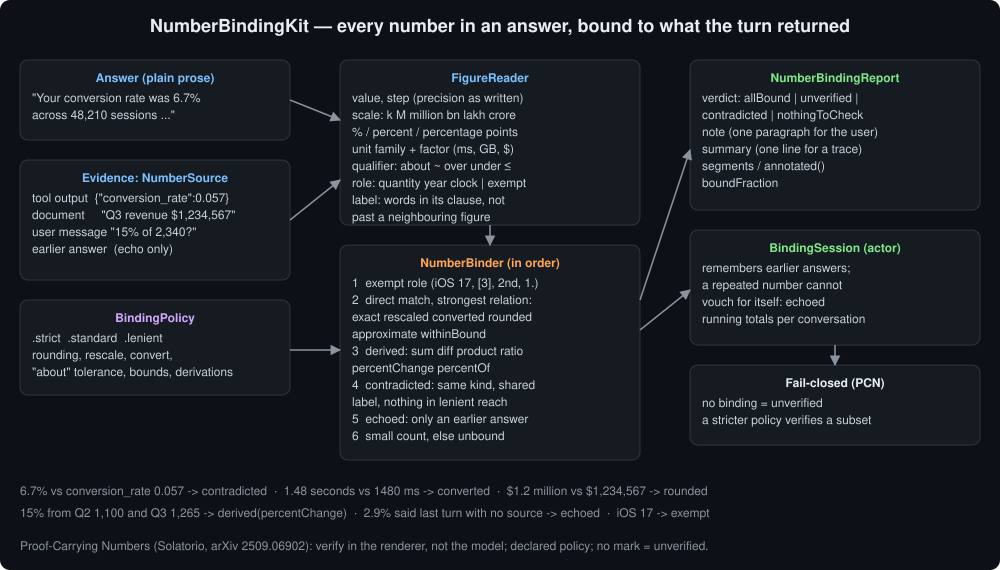
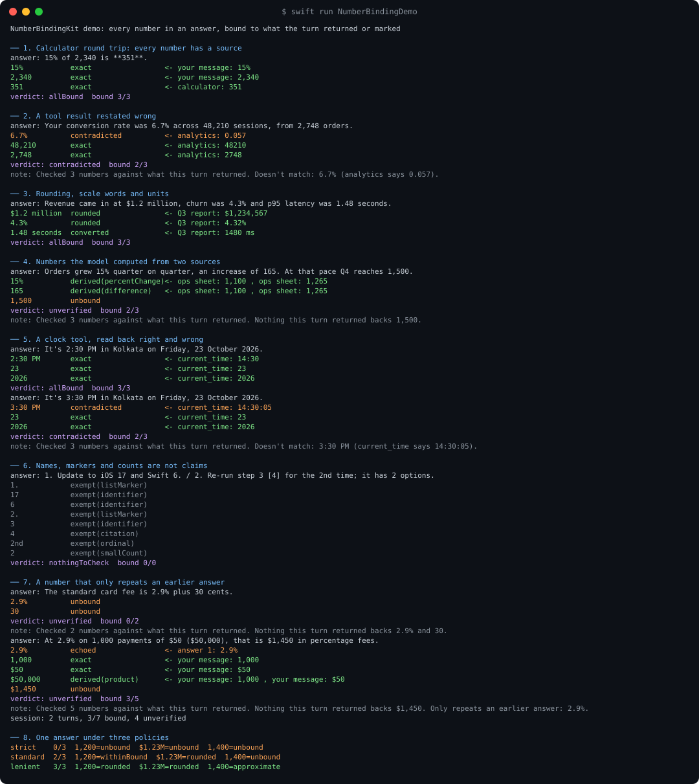
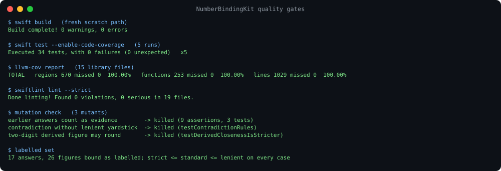

# NumberBindingKit



A user asks for their conversion rate. The analytics tool returns `{"conversion_rate":0.057,...}`.
The model writes "Your conversion rate was 6.7%." Every other word of the answer is right, the number
is formatted like a number from a tool, and nothing on screen says it is not the one the tool
returned. The same goes for a calculator result copied with two digits swapped, a clock read an hour
off, a growth rate worked out from the wrong quarter, and a fee the model made up last turn and
repeats this turn as if it were settled.

NumberBindingKit reads every number in an answer and binds it to a number the turn actually had: a
tool's output, a retrieved document, the user's own message. Each binding is made under a declared
policy (same value, rescaled, converted, rounded, "about", "over", or arithmetic on two evidence
figures), and a number that binds to nothing is reported as unverified. The answer's own history
does not count: a number that only repeats an earlier answer is `echoed`, not verified.

Part of the Swift LLM ecosystem around
[`ProviderGatewayKit`](https://github.com/rajatslakhina/foundation-model-provider-gateway).

## Why

*Proof-Carrying Numbers* (Aivin V. Solatorio, arXiv 2509.06902) argues that retrieval, citations and
uncertainty estimates cannot guarantee that a number on screen matches its source, and proposes a
presentation-layer protocol: a number is marked verified only after a mechanical check against
structured claims under a declared policy (exact, rounding, aliases, tolerance with qualifiers), the
check runs in the renderer rather than the model, and an unmarked number means unverified. The paper
states two properties this package keeps: fail-closed behaviour, and monotonicity under policy
refinement (a stricter policy never verifies more).

PCN has the model emit claim-bound tokens. A chat client that talks to whatever model the user picked
gets plain prose, so this package does the reading itself. It finds the figures in the answer and in
the evidence, with the precision, scale, unit and qualifier each was written with, and decides what
the answer's figure may honestly be matched against.

Two things this ecosystem already had do not cover it. `ClaimConsistencyKit` compares one claim
sentence with one passage sentence and flags disagreeing magnitudes; it has no notion of a tool's JSON
output, of rounding to the precision the answer wrote, or of a number the model computed. `GroundingKit`
scores sentences by overlap, and a sentence with the wrong number in it overlaps its source almost
perfectly.

## What it gives you

| Status | Meaning | Example |
|---|---|---|
| `exact` | same value, same scale | `351` of calculator `351` |
| `rescaled` | same value at another scale, or a percentage of a fraction | `1.2 million` of `1,200,000`; `5.7%` of `0.057` |
| `converted` | same quantity in another unit of the family | `1.48 seconds` of `1480 ms` |
| `rounded` | the source rounded to the answer's last digit | `$1.2 million` of `$1,234,567`; `2:30 PM` of `14:30:45` |
| `approximate` | within tolerance, and the answer said "about" | `about 1,300` of `1,296` |
| `withinBound` | inside the bound the answer stated | `over 1,200` of `1,234` |
| `derived(op)` | sum, difference, product, ratio, percent change or percent-of two evidence figures | `15%` growth from `1,100` and `1,265` |
| `contradicted` | evidence about the same thing says something else | `6.7%` against `conversion_rate 0.057` |
| `echoed` | matches only an earlier answer | `2.9%` the model stated last turn with no source |
| `unbound` | nothing the turn returned backs it | `1,500` projected with no basis |
| `exempt` | names or numbers something, or a small count in passing | `iOS 17`, `step 3`, `[4]`, `2nd`, `1.`, `2 options` |

- **`FigureReader`** reads figures: Western and Indian grouping (`1,234,567`, `12,34,567`), decimals,
  exponents, signs, currency symbols, scale words and suffixes (`k`, `M`, `million`, `bn`, `lakh`,
  `crore`), percentages (`%`, `percent`, `per cent`, `percentage points`), units with families and
  factors (time, data, length, mass, currencies that never convert), times of day (`14:30:05`,
  `2:30 PM`, `9 a.m.`), ISO timestamps, qualifiers (`about`, `~`, `over`, `no more than`, `≤`) and the
  content words around each figure, kept inside its clause and away from neighbouring figures.
- **`NumberBinder`** binds an answer against `[NumberSource]` under a **`BindingPolicy`**: `.strict`
  (same value, same form), `.standard`, `.lenient`, or your own.
- **`NumberBindingReport`** gives a verdict (`allBound`, `unverified`, `contradicted`,
  `nothingToCheck`), a one-paragraph note for the user, a one-line summary for a trace, the answer as
  segments a UI can mark, and `annotated()` for plain text.
- **`BindingSession`** is an actor for one conversation. It remembers the earlier answers so a number
  that only repeats one of them comes back `echoed`, and it keeps running totals.

## Usage

```swift
import NumberBindingKit

let binder = NumberBinder()
let report = binder.bind(
    answer: "Your conversion rate was 6.7% across 48,210 sessions, from 2,748 orders.",
    sources: [.tool("analytics", output: #"{"conversion_rate":0.057,"sessions":48210,"orders":2748}"#)]
)
report.verdict   // .contradicted
report.note      // "Checked 3 numbers against what this turn returned. Doesn't match: 6.7% (analytics says 0.057)."
report.annotated() // "Your conversion rate was 6.7% [unverified] across 48,210 sessions, from 2,748 orders."

// Across a conversation, so a repeated number cannot vouch for itself:
let session = BindingSession()
_ = await session.review(answer: "The standard card fee is 2.9% plus 30 cents.", evidence: [])
let next = await session.review(
    answer: "At 2.9% on 1,000 payments of $50 ($50,000), that is $1,450 in percentage fees.",
    evidence: [.user("And for 1,000 payments of $50 each?")]
)
next.echoed.map(\.figure.text)   // ["2.9%"]
next.unbound.map(\.figure.text)  // ["$1,450"]
```

### Rules that decide a status

- **Rounding is judged against the answer's own precision.** `6` binds to `5.7` (half a unit of the
  last digit written), `5.74` does not bind to `5.7`: an answer more precise than its source did not
  get the number from that source.
- **A derived figure needs three significant digits to round.** With sixteen evidence figures there are
  a few thousand pairwise results, and two-digit coincidences are cheap. Below three digits a
  derivation must match exactly.
- **A contradiction needs the same kind of quantity, a shared label word, and no evidence figure within
  reach of the lenient policy.** `over 1,200 users` against `1,234` is unbound under `.strict`, not
  contradicted. A time of day needs no label: a turn rarely carries two clocks.
- **The word right after a figure is its noun.** In "2,748 orders and 4,100 visits", `orders` labels
  2,748 and not 4,100.
- **Order:** exempt role, direct match (strongest relation wins), derivation, contradiction, echo,
  small count, unbound.

## Where it sits

- **ProviderGatewayKit.** Run it on the final text of a turn, with the tool results the gateway's tool
  loop produced and the user's message as sources.
- **ToolRegistryKit** and **OutcomeMonitorKit** check that a tool ran and that its result is sane. This
  package checks that the answer says what the result said.
- **GroundingKit**, **CitationBindingKit** and **ClaimConsistencyKit** check claims against passages.
  This package checks the numbers in those claims, including numbers no passage states directly.
- **StanceGuardKit** watches an answer change under pushback. This package watches an answer's numbers
  drift away from the evidence, and `BindingSession` catches the model citing itself.

## Demo

`swift run NumberBindingDemo` runs eight scenarios. Real output, abridged (the whole run is in
[`Screenshots/demo-output.txt`](Screenshots/demo-output.txt)):

```
── 2. A tool result restated wrong
   answer: Your conversion rate was 6.7% across 48,210 sessions, from 2,748 orders.
   6.7%          contradicted          <- analytics: 0.057
   48,210        exact                 <- analytics: 48210
   2,748         exact                 <- analytics: 2748
   verdict: contradicted  bound 2/3

── 4. Numbers the model computed from two sources
   answer: Orders grew 15% quarter on quarter, an increase of 165. At that pace Q4 reaches 1,500.
   15%           derived(percentChange)<- ops sheet: 1,100 , ops sheet: 1,265
   165           derived(difference)   <- ops sheet: 1,100 , ops sheet: 1,265
   1,500         unbound

── 8. One answer under three policies
   strict    0/3  1,200=unbound  $1.23M=unbound  1,400=unbound
   standard  2/3  1,200=withinBound  $1.23M=rounded  1,400=unbound
   lenient   3/3  1,200=rounded  $1.23M=rounded  1,400=approximate
```



## Install

```swift
.package(url: "https://github.com/rajatslakhina/number-binding-kit.git", from: "1.0.0")
```

Swift tools 6.0, Swift 6 language mode. macOS 13, iOS 16, tvOS 16, watchOS 9. No dependencies.

## Quality gates

All run on this machine (Swift 6.2.4, SwiftLint 0.63.2), and again on a fresh clone of this
repository after it was pushed:

- `swift build`: 0 warnings, 0 errors.
- `swift test --enable-code-coverage`: 34 tests, 0 failures, green on 5 repeated runs.
- `llvm-cov report`: **100.00%** lines (1029), regions (670) and functions (253) on all 15 library
  files ([`Screenshots/coverage.txt`](Screenshots/coverage.txt)).
- `swiftlint lint --strict`: 0 violations in 19 files, no suppressions.
- Three rules were mutation-checked: letting earlier answers count as evidence fails 9 assertions in 3
  tests, calling a contradiction without the lenient yardstick fails `testContradictionRules`, and
  letting a two-digit derived figure round fails `testDerivedClosenessIsStricter`.
- The labelled set (17 answers, 26 figures) binds as labelled, and every case verifies a subset under
  `.strict` of what it verifies under `.standard`, and under `.standard` of `.lenient`.

The demo was the generalisation check. Scenarios and tests written after the first tests passed
exposed five gaps, each fixed and pinned by a test: a percentage was "contradicted" by `1,000` because
any unit-less number counted as a fraction; `.strict` called true-but-loose figures contradictions;
label windows ran across neighbouring figures, so `active seats` labelled `$1.23M`; after bounding the
windows, a clock lost the label that let it contradict the tool's time; and the noun after one figure
still labelled the next (`orders` in "2,748 orders and 4,100 visits").



## Limits, stated plainly

- **Lexical, English formats only.** Numbers written as words ("three", "a dozen"), decimal commas
  (`5,7 %`), space-grouped thousands and non-Latin digits are not read. A bare JSON array of numbers
  (`[12,345,678]`) reads as one grouped number.
- **A single letter after a space is not a unit.** `5 s` and `5 m` are too ambiguous; `5s`, `5 sec`
  and `$5m` (million, because of the currency symbol) are read.
- **Labels are a heuristic.** A contradiction needs the answer and the evidence to share a content word
  near the number. Without one, a wrong number is `unbound` rather than `contradicted`: still flagged,
  but named less precisely.
- **Derivations can coincide.** They are limited to pairs, to sixteen evidence figures (twenty-four
  under `.lenient`) and to exact matches below three significant digits, and they still read a number
  as derived when it merely equals some sum. A derived binding says the arithmetic is available, not
  that the model did it.
- **World knowledge is unbound by design.** A correct year or constant the model knows but the turn
  never returned is reported as unverified. Run the binder on turns that carried evidence, or show
  `unbound` as "not checked", not "wrong".
- **The labelled set is small and home-made.** Seventeen answers written alongside the code show the
  rules do what they say, not how often real answers trip them.

## License

MIT. See [LICENSE](LICENSE).
